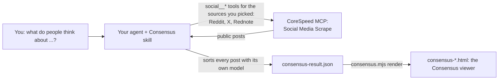

# Consensus, CoreSpeed edition

Ask your AI agent "what do people think about X?" and get a cited answer from
real public posts on Reddit, X and, when you pick it, Rednote (Xiaohongshu).
Your agent reads the posts through CoreSpeed's built-in **Social Media Scrape**
capability, the `social__*` tools of the [CoreSpeed](https://corespeed.io) MCP
server, and sorts them with its own model. Then it shows the result in the
original Consensus interface: the answers people give, how many posts in each
source's sample give each, the reasons behind them, and a link to every post.

This is an agent **skill** plus a **static viewer**. There is no server to run,
no second model to configure, and no scraping or proxy account to buy.

What you need, and what you do not:

- **You need** a CoreSpeed account, your agent signed in to the CoreSpeed MCP
  server, and the social capability on for you. CoreSpeed lists it as "Social
  media research" in Dashboard → Tools. Only you change that setting; the skill
  never does.
- **You do not need** a third-party scraping service, separate X, Reddit or
  Rednote API keys, or a connected social media account. CoreSpeed reads
  public data on its own supplier accounts; nothing logs in as you.

> Based on [Consensus](https://github.com/Straitly-ai/consensus) by Straitly,
> released under the MIT licence. The sorting method and the interface come from
> that project. This edition is maintained by CoreSpeed and is not endorsed by
> the original authors. The original README is in
> [docs/upstream-README.md](docs/upstream-README.md).


## How it works



1. When the skill starts, the agent lists the `social__*` tools its CoreSpeed
   connection exposes and reads each tool's live description and schema,
   including its rate. It plans from those, not from a fixed list.
2. It picks the sources: the ones you name, or Reddit and X. It plans one
   counted budget of requests and shows you the sources, the split and the
   credits before the first call.
3. It calls the CoreSpeed social tools through the MCP connection it already
   has. CoreSpeed is the only data source; it needs no TwitterAPI.io, Serper,
   Oxylabs, Reddit or Xiaohongshu account.
4. It sorts every post with the Consensus rubric: an answer option, Other, no
   answer, or spam. A post that only mentions something is not a vote.
5. It writes `consensus-result.json` once, in your language: every sorted post
   with its link, plus coverage per source, usage, and the queries it ran.
6. `consensus.mjs render` checks the file and builds one self-contained HTML
   page. You open it from disk; it fetches nothing and runs no model.

## Sources

| Source | CoreSpeed tools | Rate stated on 2026-10-14 |
| --- | --- | ---: |
| Reddit | `social__reddit_search`, `social__reddit_post_comments` | 1.5 credits |
| X | `social__x_search`, `social__x_post_comments` | 1.5 credits |
| Rednote (小红书) | `social__xiaohongshu_search_notes`, `social__xiaohongshu_note_comments` | 15 credits |

Reddit and X are the default. Rednote is used only when you ask for it. Each
source is reported as its own sample. LinkedIn is not supported: CoreSpeed has
no LinkedIn post search, and the skill will not substitute profile search,
another provider or a signed-in browser.

## Install

You need an agent that loads skills (Claude Code, Codex, Cursor, OpenClaw,
Hermes, or the Claude app) and a CoreSpeed connection. Node.js 18+ is needed
only for the viewer step.

**1. Connect CoreSpeed** (skip this if your agent already lists `social__*`
tools). This is the only sign-in: one CoreSpeed connection, no social media
accounts. Give your agent the official setup line:

```text
set up https://corespeed.io/SKILL.md (read it raw, e.g. with curl)
```

Or, in Claude Code, add the server yourself and sign in with `/mcp`:

```bash
claude mcp add corespeed https://api.corespeed.io/mcp --transport http --scope user
```

A free CoreSpeed account works: https://app.corespeed.io/sign-up. "Social
media research" must be on for you at https://app.corespeed.io/tools; if the
`social__*` tools are missing while other CoreSpeed tools are there, that is
the usual cause. Never paste an API key into a chat. Headless agents use a key
in an environment variable, as the official setup describes.

**2. Add the skill.**

- With the skills CLI: `npx skills add corespeed-io/consensus --skill consensus -g -y`
- Or copy the folder `skills/consensus` to your agent's user-level skills folder:

| Agent | Folder |
| --- | --- |
| Claude Code | `~/.claude/skills/consensus/` |
| Codex and most others | `~/.agents/skills/consensus/` |
| Cursor | `~/.cursor/skills/consensus/` |
| Claude app | Customize → Skills → Upload a ZIP whose root is the `consensus` folder |

```bash
git clone https://github.com/corespeed-io/consensus.git
mkdir -p ~/.claude/skills && cp -R consensus/skills/consensus ~/.claude/skills/
```

**3. Ask.** For example: "Why do developers switch from Cursor to Claude
Code?", "Is a standing desk worth it? Reddit only, last 6 months.", or
"小红书上大家怎么评价 Claude Code？ Include Rednote."

## Cost

Each social tool states its price in its description, and rates differ by
source. On 2026-10-14 the Reddit and X tools stated **1.5 credits** per
successful request and the Rednote tools **15 credits**. Failed requests are
never charged. The agent reads the live rate of every tool it plans to use, so
these numbers can change without a new skill version.

The skill plans **one total budget of requests**, retries and later pages
included. The depth sets it: Quick 8, Standard 14, Deep 30 (Deep asks first).
The sources you pick share that total; adding a source never adds requests.
Before the first call the agent tells you the sources, the requests per source
and the credits the cap can cost at the live rates. A plan with Rednote waits
for your OK, because its rate is ten times higher.

| Standard (14 requests) | Reddit | X | Rednote | Credits at most |
| --- | ---: | ---: | ---: | ---: |
| Reddit + X (default) | 9 | 5 | – | 21 |
| Reddit + X + Rednote | 5 | 4 | 5 | 88.5 |
| Rednote only | – | – | 14 | 210 |

These are estimates from the stated rates. A request that times out or drops
its connection may already have run and been charged. The result records
those as charge-unknown, and the page shows the cost as a range. The exact
charges are in your CoreSpeed Activity log.

The CoreSpeed Free plan includes 3,000 credits per 90 days
([pricing](https://corespeed.io/pricing)). Your agent's own model usage is
separate and depends on your agent.

## The example

[`skills/consensus/examples/`](skills/consensus/examples/) holds a real run
from 2026-10-14 on Reddit and X. Its question was "Why do developers switch
from Cursor to Claude Code?", over the last 12 months:

- 14 successful CoreSpeed requests (21 credits at the published rate). 3 more lost the connection and were retried; their charge is unknown, so the cost was 21 to 25.5 credits.
- 143 posts read, 42 dropped before sorting, 101 sorted, 45 opinions counted.
- The result file and the rendered page are both in that folder.

A second, smaller example reads Rednote only, in Chinese:
`rednote-cursor-vs-claude-code.json` asks "小红书上，Cursor 和 Claude Code
大家选哪个？". It made 3 Rednote requests (2 search pages and 1 comment page,
45 credits at the stated rate), read 60 items, and counted 23 opinions: Cursor 8,
Claude Code 8, both 7. Six of the Cursor votes come from one note's comments,
and its limits say so.


Both are recorded snapshots, not live results. Ask your agent to run it again
for current data. Its labels were revised once, from the same collected posts:
an independent test of the skill tightened the rubric to one vote per author
per thread, which moved the count from 49 to 45. The page records this.

| Answer (of 45 opinions counted in this sample) | Opinions |
| --- | ---: |
| Stayed with or went back to Cursor | 16 |
| More usage for the money | 14 |
| Better results in Claude Code | 7 |
| No need for Cursor's IDE | 4 |
| Uses both | 3 |
| Other | 1 |

One X search deliberately looked for people staying with Cursor, so that
answer is over-sampled by design. The page lists this and the other limits.

## What the viewer shows

The original Consensus results screen: the answer donut, a "why" summary per
answer, themes that filter the posts, and every post with its author, date,
score and a link to the original. CoreSpeed additions:

- source switches narrow the whole page to the sources you tick. They only
  filter posts already in the file: nothing is fetched, nothing is charged,
  and a source the run did not collect is never shown as having results;
- counts per source, and every share labelled as a share of the opinions
  counted in the selected sources' sample;
- below 15 counted opinions, shares are hidden and the sample is called thin;
- the interface in English, 简体中文, 日本語 and 한국어, from dictionaries built
  into the page. Switching costs no model tokens. The report itself stays in
  the one language your agent wrote it in, and the page says so when the two
  differ; posts are always shown as written;
- light and dark themes, in Vercel's Geist type with a light sky-blue accent;
- a panel lists what was read, what it cost, the queries run, and the limits;
- there is no search box: the page is a snapshot, so follow-ups go through
  your agent.

The page is locked down: scripts run only by hash, it makes no network
requests, images load only from X, Reddit and Rednote's image domains, and
every link must be an `https://` X, Reddit or Rednote post link that matches
its post id.


## Helper commands

`skills/consensus/scripts/consensus.mjs` is optional and offline. It never
calls CoreSpeed or a model.

```bash
node consensus.mjs validate consensus-result.json   # check the file, print counts and cost
node consensus.mjs render consensus-result.json --open   # build and open the viewer page
node consensus.mjs ingest social__x_search saved-result.json   # turn a saved tool result into evidence rows
```

`validate` checks structure, labels, verbatim quotes, link form against each
post id, the window, and the usage arithmetic. It cannot prove a post still
exists; only the agent's own reads show that.

## Develop

```bash
npm install
npm run test:skill        # skill tests (node:test): normalizers on recorded payloads, validation, hostile input
npx tsc --noEmit -p web   # type-check the viewer
npm run viewer:dev        # dev server; open /?data=/cursor-to-claude-code.json
npm run viewer:build      # rebuild skills/consensus/viewer/consensus-viewer.html
```

Rebuild the viewer after changing anything in `web/` or
`skills/consensus/scripts/result.mjs`, and commit the built file. Skill users
never build anything.

| Path | What it is |
| --- | --- |
| `skills/consensus/` | The skill: `SKILL.md`, references, the helper scripts, the built viewer, the example |
| `web/` | The original Consensus interface, adapted as the viewer |
| `test/skill/` | Skill tests and the recorded CoreSpeed payloads they use |
| `src/`, `netlify/`, `scripts/` | The original Consensus server pipeline, unchanged. This edition does not use it; it needs its own provider keys |

## Limits

- **A sample, not a survey.** Search ranking decides what is read, and people
  who post are not everyone. The skill tells the agent never to report
  population shares or market share, and `validate` rejects a summary that
  reads like one.
- **Reddit coverage is partial.** A comments request returns about 8 comments.
  The skill reads the top comments of a few threads and does not open nested
  "load more" replies.
- **X search is passed through as typed.** In testing, `since:`, `lang:en` and
  plain AND-ed words were honoured. One query with an OR group of quoted
  phrases returned 20 posts, and none of them contained the phrases. The skill
  checks each post's date and words itself.
- **Pages are large.** An X page is 43,000 to 68,000 characters, so a Deep
  run fills a lot of agent context.
- **English only by default** for Reddit and X posts. Rednote posts are mostly
  Chinese.
- **Rednote shows only the start of a note in search** (about 60
  characters), and there is no tool for a note's full text. Comments are
  complete. Note links need their `xsec_token`, and Rednote may ask readers to
  sign in to open them. The next comment page (`cursor`) was not tested live.
- **No LinkedIn.** See Sources.

## Licence

MIT. See [LICENSE](LICENSE); the original copyright notice is kept unchanged.

The viewer embeds the Geist Sans font by Vercel, under the SIL Open Font
License 1.1. Its licence is in
[`skills/consensus/viewer/GEIST-FONT-LICENSE.txt`](skills/consensus/viewer/GEIST-FONT-LICENSE.txt)
and inside every rendered page. Readers whose browser cannot use it see the
system font instead.
